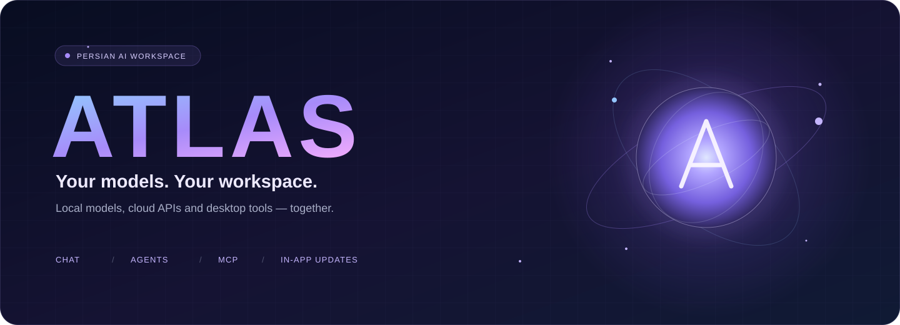
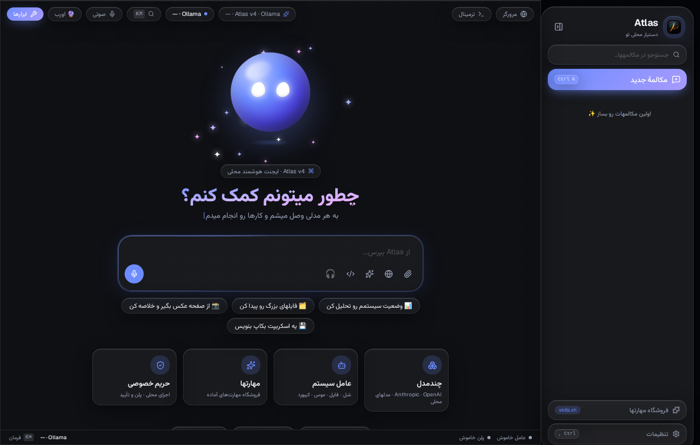
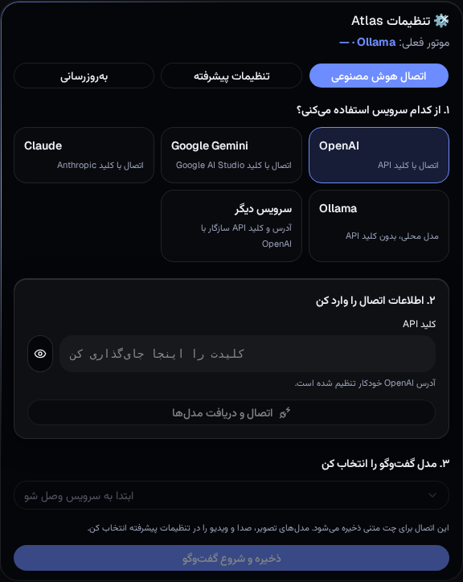
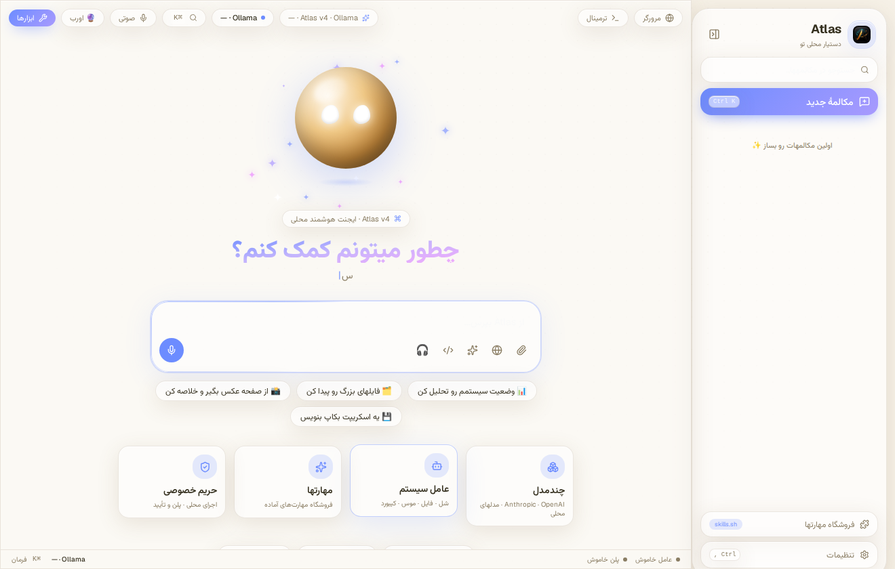
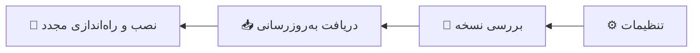
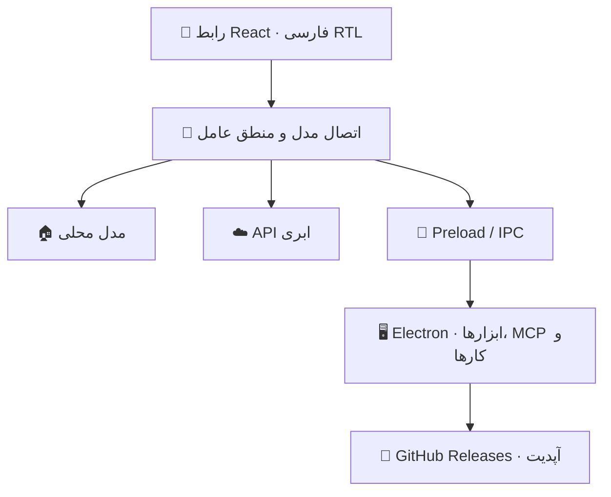

<div align="center">



# 🌌 Atlas · فضای کار هوشمند شما

**مدل‌های محلی و ابری، گفت‌وگوی فارسی و ابزارهای دسکتاپ؛ در یک محیط واحد.**

[](https://github.com/aec-lang/Atlas-v4/releases/latest)
[](https://github.com/aec-lang/Atlas-v4/actions/workflows/build.yml)


### [📥 دانلود](https://github.com/aec-lang/Atlas-v4/releases/latest) · [⚡ شروع سریع](#quick-start) · [🖼️ تصاویر](#gallery) · [🔄 آپدیت داخلی](#updates)

</div>

---

Atlas یک برنامهٔ دسکتاپ با رابط فارسی و راست‌به‌چپ است. مدل دلخواهتان را وصل کنید، مکالمه‌ها را مدیریت کنید و در حالت عامل، کارهایی مثل خواندن فایل یا اجرای دستور را به مدل بسپارید. رابط شیشه‌ای، هشت تم و پنل‌های ابزار، همه در همان فضای کار در دسترس‌اند.

> ✨ **تازه در سری 4.3:** راه‌اندازی ساده‌تر اتصال هوش مصنوعی و دریافت به‌روزرسانی از داخل برنامه. نسخه‌های 4.2.x برای فعال شدن آپدیت داخلی باید یک بار به 4.3.0 یا جدیدتر ارتقا پیدا کنند.

<a id="gallery"></a>
## 🖼️ یک نگاه به Atlas

### 🌙 فضای اصلی · تم تیره



<table>
  <tr>
    <td width="50%" align="center">
      
      <br /><strong>🔌 اتصال سادهٔ API</strong><br />انتخاب سرویس، اطلاعات اتصال و مدل
    </td>
    <td width="50%" align="center">
      
      <br /><strong>☀️ فضای روشن</strong><br />یکی از هشت تم داخلی برنامه
    </td>
  </tr>
</table>

<sub>تصاویر از رابط واقعی برنامه در پیش‌نمایش وب، با تنظیمات اولیه و بدون کلید API گرفته شده‌اند. ابزارهای سیستمی و آپدیت داخلی به نسخهٔ دسکتاپ نیاز دارند.</sub>

## ✨ چه کارهایی می‌توانید انجام دهید؟

| | قابلیت | کاربرد |
|:--:|---|---|
| 💬 | **گفت‌وگو با مدل دلخواه** | Ollama، OpenAI، سرویس‌های سازگار با OpenAI و Anthropic |
| 🔌 | **راه‌اندازی مرحله‌ای اتصال** | انتخاب سرویس، وارد کردن کلید یا آدرس و دریافت فهرست مدل‌ها |
| 🖥️ | **عامل دسکتاپ** | اجرای دستور، کار با فایل‌ها، کلیپبورد و گرفتن تصویر صفحه |
| 🧩 | **کانکتورهای MCP** | اتصال ابزارها و سرویس‌های بیرونی از طریق HTTP یا stdio |
| 🛠️ | **مهارت‌ها** | نصب از فهرست مهارت‌ها و فعال‌سازی برای هر مکالمه |
| 📚 | **کار با دانش محلی** | پنل RAG محلی، جست‌وجوی معنایی و حافظهٔ بلندمدت |
| ⏰ | **کارها و زمان‌بندی** | مدیریت وظایف پس‌زمینه و اجرای زمان‌بندی‌شده در زمان باز بودن برنامه |
| 🗂️ | **مدیریت مکالمه‌ها** | ساخت، تغییر نام، سنجاق، ستاره و گروه‌بندی |
| 🌐 | **مرورگر و ترمینال داخلی** | دسترسی به صفحات و اجرای دستور در فضای برنامه |
| 🎨 | **ظاهر قابل انتخاب** | هشت تم، حالت روشن و تیره و چینش فارسی RTL |
| 🔄 | **آپدیت داخلی** | بررسی نسخه، دانلود و نصب از بخش تنظیمات |

## 📥 دانلود و نصب

**[دریافت آخرین نسخه از GitHub Releases →](https://github.com/aec-lang/Atlas-v4/releases/latest)**

فایل متناسب با سیستم خود را انتخاب کنید. نمونهٔ نام‌ها مربوط به **4.3.0** است؛ شمارهٔ نسخه در انتشارهای بعدی تغییر می‌کند.

| سیستم | بسته | مناسب برای |
|---|---|---|
| 🐧 Linux x64 | `Atlas-4.3.0-x86_64.AppImage` | اجرای مستقل و دریافت تفاضلی آپدیت‌ها |
| 🐧 Debian / Ubuntu x64 | `atlas-v4_4.3.0_amd64.deb` | نصب یکپارچه با مدیر بستهٔ سیستم |
| 🪟 Windows x64 | `Atlas-4.3.0-x64-Setup.exe` | نصب معمولی و استفاده از آپدیت داخلی |
| 🧳 Windows x64 | `Atlas-4.3.0-x64.exe` | اجرای پرتابل؛ ارتقا با دریافت دستی نسخهٔ بعد |
| 🍎 macOS Apple Silicon | `Atlas-4.3.0-arm64.dmg` | نصب روی مک‌های دارای پردازندهٔ سری M |

<details>
<summary>🐧 نصب روی لینوکس</summary>

**AppImage** — فایل را دانلود کنید و اجازهٔ اجرا بدهید:

```bash
chmod +x Atlas-4.3.0-x86_64.AppImage
./Atlas-4.3.0-x86_64.AppImage
```

برای آپدیت داخلی، فایل را در پوشه‌ای نگه دارید که اجازهٔ نوشتن در آن دارید.

**DEB** — در پوشهٔ دانلود فایل اجرا کنید:

```bash
sudo apt install ./atlas-v4_4.3.0_amd64.deb
```

</details>

<details>
<summary>🪟 نصب روی ویندوز</summary>

فایل **Setup** را اجرا کنید و مراحل نصب را ادامه دهید. این نسخه برای دریافت آپدیت از داخل برنامه مناسب است. نسخهٔ **Portable** بدون نصب اجرا می‌شود؛ برای فعال شدن مسیر آپدیت داخلی، به نسخهٔ Setup مهاجرت کنید.

</details>

<details>
<summary>🍎 نصب روی مک</summary>

فایل DMG مخصوص **Apple Silicon / arm64** را باز کنید و برنامه را به پوشهٔ Applications منتقل کنید. تا زمان فراهم شدن امضای معتبر برنامه، ارتقا روی مک از مسیر دریافت دستی انجام می‌شود.

</details>

<a id="quick-start"></a>
## ⚡ از نصب تا اولین پیام

### ۱ · برنامه را باز کنید 🪄

از نوار کناری وارد **تنظیمات ← اتصال هوش مصنوعی** شوید. برای شروع نیازی به دست‌کاری تنظیمات پیشرفته ندارید.

### ۲ · مدل خود را وصل کنید 🔌

| نوع اتصال | چه چیزی لازم دارید؟ |
|---|---|
| 🏠 **Ollama محلی** | Ollama در حال اجرا، یک مدل نصب‌شده و آدرس سرور؛ معمولاً `http://localhost:11434` |
| ☁️ **OpenAI** | کلید API حساب خود و یک مدل در دسترس |
| 🧠 **Anthropic** | کلید API رسمی Anthropic و مدل مجاز برای حساب |
| 🔗 **سازگار با OpenAI** | آدرس API سرویس، کلید در صورت نیاز و نام مدل؛ مانند LM Studio، LiteLLM یا vLLM |

در راهنمای اتصال، **سرویس را انتخاب کنید → کلید یا آدرس را وارد کنید → مدل‌ها را دریافت و مدل را انتخاب کنید → ذخیره کنید**. دسترسی به مدل‌ها به سرویس و حساب شما بستگی دارد.

> 💡 Atlas رابط اتصال به مدل‌هاست؛ کلید API، اعتبار سرویس ابری یا فایل مدل را همراه خود ارائه نمی‌کند. برای اجرای محلی، سرویس مدل باید جداگانه در حال اجرا باشد.

### ۳ · اولین گفت‌وگو را شروع کنید 💬

یک مکالمه بسازید و پیام بفرستید. مثلاً:

```text
این متن را خلاصه کن و نکته‌های اصلی را به فارسی بنویس.
```

برای کار با فایل و سیستم، از نسخهٔ دسکتاپ استفاده کنید و **حالت عامل** را در تنظیمات فعال کنید. مدل انتخاب‌شده هم باید فراخوانی ابزار را پشتیبانی کند.

<a id="updates"></a>
## 🔄 آپدیت از داخل برنامه

در **تنظیمات ← به‌روزرسانی**، نسخهٔ تازه را بررسی کنید، دانلود را شروع کنید و سپس **نصب و راه‌اندازی مجدد** را بزنید. برنامه پس از شروع و سپس هر شش ساعت نسخه را بررسی می‌کند؛ دانلود و نصب با انتخاب شما انجام می‌شوند.



| بستهٔ نصب‌شده | روش ارتقا | حجم دریافت |
|---|---|---|
| 🐧 AppImage | از داخل برنامه | تفاضلی در صورت امکان؛ دریافت کامل در صورت نیاز |
| 🪟 Windows Setup | از داخل برنامه | تفاضلی در صورت امکان؛ دریافت کامل در صورت نیاز |
| 🐧 DEB | از داخل برنامه؛ ممکن است مجوز مدیر بخواهد | فایل کامل بسته |
| 🧳 Windows Portable | دریافت دستی یا مهاجرت به Setup | فایل کامل |
| 🍎 macOS | دریافت دستی از صفحهٔ انتشار | فایل کامل |

**چرا DEB را انتخاب کنم؟** برای نصب معمولی روی Debian و Ubuntu انتخاب مناسبی است. اگر اولویتتان کاهش حجم دانلود آپدیت‌هاست، **AppImage** مناسب‌تر است. کاهش حجم به میزان تغییرات و پشتیبانی سرور بستگی دارد و درصد ثابتی ندارد.

قبل از نصب، کارهای جاری را تمام کنید. تنظیمات و مکالمه‌ها در محل داده‌های برنامه باقی می‌مانند. فایل‌های `latest*.yml` و `*.blockmap` در ریلیز برای آپدیت‌کننده‌اند و نیازی به دانلود دستی آن‌ها ندارید.

## 🧠 فراتر از گفت‌وگو

### 🖥️ ابزارهای عامل

در نسخهٔ دسکتاپ، عامل می‌تواند از ابزارهای ترمینال، خواندن و نوشتن فایل، مدیریت فرآیندها، کلیپبورد، تصویر صفحه و حافظه استفاده کند. کنترل موس و کیبورد در لینوکس به `xdotool` وابسته است. حالت عامل به‌صورت پیش‌فرض خاموش است و اجرای دستورهای حساس مسیر تأیید دارد.

### 🧩 کانکتورها و مهارت‌ها

از **ابزارها ← کانکتورها** اتصال‌های MCP را مدیریت کنید. اتصال stdio به اجرای محلی سرویس مربوط نیاز دارد؛ اتصال HTTP به آدرس سرویس نیاز دارد. مهارت‌ها نیز از فهرست مهارت‌ها قابل نصب‌اند و برای هر مکالمه می‌توان آن‌ها را فعال یا غیرفعال کرد.

### ⏰ کارها، پلن و دانش محلی

پنل ابزارها بخش‌هایی برای کارهای پس‌زمینه، زمان‌بندی، حالت پلن، RAG محلی، مقایسهٔ مدل‌ها و بازپخش جلسه دارد. اجرای زمان‌بندی‌ها به در حال اجرا بودن برنامه وابسته است. برای قابلیت‌های متکی به مدل یا سرویس بیرونی، ابتدا اتصال مربوط را تنظیم کنید.

### 🎬 خروجی چندرسانه‌ای

رابط برنامه نمایش تصویر، صوت و ویدئو را پشتیبانی می‌کند. مسیرهای `/image`، `/tts`، `/video` و `/3d` به تنظیم موتور مربوط وابسته‌اند؛ سرویس انتخاب‌شده باید آن قابلیت را ارائه دهد. تولید ویدئو و مدل سه‌بعدی به تنظیم API و قالب درخواست سرویس نیاز دارد. ورودی صوتی نیز به پشتیبانی محیط و اجازهٔ میکروفون وابسته است.

## 🎨 تمی برای حال‌وهوای شما

| 🌙 نیمه‌شب | 🌌 شفق | 📄 کاغذی | 💜 لاوندری |
|:--:|:--:|:--:|:--:|
| Midnight | Aurora | Paper | Lavender |
| 🌇 **غروب** | 🌊 **اقیانوس** | 🌹 **رز** | 🌲 **جنگل** |
| Sunset | Ocean | Rose | Forest |

از گالری تم در صفحهٔ اصلی، ظاهر دلخواهتان را انتخاب کنید. تصاویر بالای صفحه نمونهٔ تم نیمه‌شب و کاغذی هستند.

## 🔐 داده‌ها و دسترسی‌ها

- 🏠 **مدل محلی:** با اتصال به Ollama محلی، پردازش درخواست مدل روی سرور محلی شما انجام می‌شود.
- ☁️ **مدل ابری:** متن‌ها و داده‌هایی که در درخواست استفاده می‌شوند به ارائه‌دهندهٔ انتخاب‌شده ارسال می‌شوند.
- 💾 **ذخیره‌سازی:** تنظیمات و مکالمه‌ها محلی نگه داشته می‌شوند. ذخیرهٔ کلید API را نباید معادل یک مخزن رمزگذاری‌شدهٔ اسرار در نظر گرفت.
- 🖥️ **دسترسی سیستم:** ابزارهای عامل روی سیستم واقعی اجرا می‌شوند؛ درخواست تأیید را پیش از اجرا بررسی کنید.
- 🌐 **پروکسی:** تنظیمات پیشرفته از پروکسی HTTP و SOCKS5 پشتیبانی می‌کند. این قسمت برای لینک‌های VLESS/VMess یا اشتراک VPN نیست.

نسخهٔ مرورگر به محدودیت‌های CORS و APIهای مرورگر وابسته است. برای ترمینال، ابزارهای سیستمی و آپدیت داخلی، نسخهٔ دسکتاپ را اجرا کنید.

## 🧑‍💻 توسعه و ساخت

پروژه با **React + TypeScript + Vite** ساخته شده و پوستهٔ دسکتاپ آن **Electron** است. محیط CI از **Node.js 22** استفاده می‌کند.

```bash
git clone https://github.com/aec-lang/Atlas-v4.git
cd Atlas-v4
npm ci
npm run dev
```

| دستور | کاربرد |
|---|---|
| `npm run dev` | پیش‌نمایش توسعه در مرورگر |
| `npm run build` | بررسی TypeScript و ساخت رابط وب |
| `npm run preview` | پیش‌نمایش خروجی ساخته‌شده |
| `npm run app` | اجرای Electron؛ خروجی وب باید از قبل ساخته شده باشد |
| `npm test` | تست‌های واحد با Vitest |
| `npm run test:updater` | تست چرخهٔ آپدیت و دسترسی IPC |
| `npm run lint` | بررسی کد با Oxlint |

### 🏗️ ساخت و انتشار در GitHub Actions

ورک‌فلوی [Build & Release](.github/workflows/build.yml) تست‌ها و ساخت بسته‌ها را انجام می‌دهد. انتشار روی تگ‌های `v*` انجام می‌شود و فایل‌های نصب همراه با متادیتای آپدیت در GitHub Releases قرار می‌گیرند. برای ساخت نسخه‌های قابل انتشار، از همین مسیر استفاده کنید.

تصاویر README نیز با ورک‌فلوی دستی [Refresh README screenshots](.github/workflows/readme-screenshots.yml) از رابط واقعی ساخته می‌شوند؛ اسکریپت آن در [scripts/capture-readme.mjs](scripts/capture-readme.mjs) قرار دارد.

### 🗺️ نقشهٔ سورس

```text
Atlas-v4/
├── src/
│   ├── components/       رابط گفت‌وگو، تنظیمات و پنل‌های ابزار
│   ├── lib/              اتصال مدل‌ها، منطق عامل و ابزارهای مشترک
│   ├── stores/           وضعیت تنظیمات، مکالمه‌ها و مهارت‌ها
│   └── types/            قراردادهای TypeScript و پل دسکتاپ
├── desktop/
│   ├── main.cjs          ورودی Electron
│   ├── preload.cjs       پل ایزولهٔ رابط و دسکتاپ
│   ├── backend.cjs       اجرای ابزارهای سیستم
│   ├── updater.cjs       دریافت و نصب به‌روزرسانی
│   ├── mcp.cjs           اتصال‌های MCP
│   └── tasks.cjs         وظایف پس‌زمینه
├── tests/                تست‌های دسکتاپ
├── scripts/              بررسی فایل‌های انتشار و ثبت تصاویر
├── docs/assets/          بنر و اسکرین‌شات‌های README
└── .github/workflows/    ساخت، انتشار و تهیهٔ تصاویر
```



## 🧯 پرسش‌های رایج

<details>
<summary>🔌 چرا فهرست مدل‌ها دریافت نمی‌شود؟</summary>

آدرس سرویس، کلید API و دسترسی شبکه را بررسی کنید. در اتصال محلی، مطمئن شوید سرویس در حال اجراست. در سرویس سازگار با OpenAI، آدرس پایه باید با مستندات همان سرویس مطابقت داشته باشد. خطای CORS ممکن است فقط در پیش‌نمایش مرورگر دیده شود.

</details>

<details>
<summary>🖥️ چرا عامل یا ترمینال در مرورگر کار نمی‌کند؟</summary>

این قابلیت‌ها به پل Electron و سیستم محلی نیاز دارند. نسخهٔ دسکتاپ را اجرا کنید؛ برای فراخوانی ابزار توسط مدل نیز حالت عامل را فعال و یک مدل سازگار انتخاب کنید.

</details>

<details>
<summary>🔄 چرا گزینهٔ آپدیت داخلی را نمی‌بینم؟</summary>

نسخه‌های پیش از 4.3.0 این قابلیت را ندارند. یک بار نسخهٔ جدید را از Releases نصب کنید. نسخهٔ Portable ویندوز و نسخهٔ مک مسیر دریافت دستی دارند. AppImage باید در مسیر قابل نوشتن باشد.

</details>

<details>
<summary>📦 آیا برای هر آپدیت باید چندصد مگابایت دانلود کنم؟</summary>

در AppImage و Windows Setup، آپدیت‌کننده در صورت امکان فقط بخش‌های تغییرکرده را دریافت می‌کند؛ اگر دریافت تفاضلی ممکن نباشد، فایل کامل دانلود می‌شود. DEB از مسیر دریافت کامل بسته استفاده می‌کند.

</details>

## 🤝 گزارش مشکل و مالکیت

برای گزارش مشکل، [یک Issue باز کنید](https://github.com/aec-lang/Atlas-v4/issues) و نسخهٔ Atlas، سیستم‌عامل، نوع بسته و مراحل بازتولید را بنویسید. کلید API و اطلاعات خصوصی را از گزارش و تصاویر حذف کنید.

سازندهٔ درج‌شده در پروژه: **[alavi8940-tech](https://github.com/alavi8940-tech)**. پرامپت پایهٔ قفل متعلق به سازنده است. این مخزن در حال حاضر فایل مجوز مستقل ندارد؛ شرایط استفاده و بازتوزیع را از مالک پروژه پیگیری کنید.

---

<div align="center">

**🌌 Atlas — مدل انتخابی شما، در فضای کار شما.**

[📥 دریافت برنامه](https://github.com/aec-lang/Atlas-v4/releases/latest) · [🐛 گزارش مشکل](https://github.com/aec-lang/Atlas-v4/issues) · [⚙️ وضعیت ساخت](https://github.com/aec-lang/Atlas-v4/actions/workflows/build.yml)

</div>
